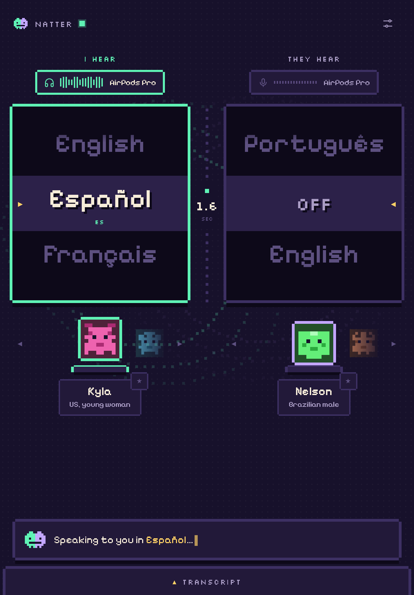
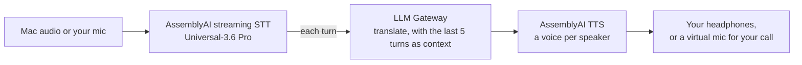

<p align="center">
  
</p>

<p align="center">
  <a href="LICENSE"></a>
  
  
  <a href="https://www.assemblyai.com"></a>
</p>

**Natter** is a tiny Mac app that translates speech as it happens. Turn the left dial and anything your Mac plays (a
call, a livestream, a video, a meeting) is spoken into your headphones in your language. Turn the right dial and the
people on your call hear *you* in theirs. Every voice is a little pixel critter you can swap on the fly.

<p align="center">
  <a href="https://github.com/dan-ince-aai/natter/releases/latest/download/Natter.dmg"><b>▼ Download free for Mac</b></a> (ready in about a minute) ·
  <a href="https://dan-ince-aai.github.io/natter/">Website</a> ·
  <a href="docs/assets/natter-ad.mp4">Watch the 60-second video</a>
</p>

<p align="center"></p>


## Build this into your app

Real-time translation with AssemblyAI is one WebSocket for speech-to-text **and** translation, plus one for the voice.
The trick is the `llm_gateway` parameter: it runs your prompt on every finished turn, on the same streaming session.

```python
stt = connect("wss://streaming.assemblyai.com/v3/ws",
    sample_rate=16000, encoding="pcm_s16le", speech_model="universal-3-6-pro", mode="min_latency",
    llm_gateway=json.dumps({
        "model": "gemini-2.5-flash-lite",
        "prompt": "Translate what the speaker just said into natural Spanish. Reply with only the translation.\n\n{{turn}}",
    }))
# ...stream mic audio in; each translation arrives as an LLMGatewayResponse message.
# Send it to wss://tts.us.assemblyai.com/v1/ws as {"type": "Generate", "text": ...} + {"type": "Flush"} and play the audio.
```

[`examples/realtime_translate.py`](examples/realtime_translate.py) is the whole loop in about 100 lines: mic → speech-to-text +
translation → text-to-speech → speakers. It's the core of Natter without the app:

```sh
pip install websockets sounddevice numpy
export ASSEMBLYAI_API_KEY=your-key   # https://www.assemblyai.com/dashboard/api-keys
python examples/realtime_translate.py --to Spanish --voice aai-antonioluis   # wear headphones
```

**Ideas to build with it:** a browser extension that dubs any tab, a phone-line interpreter (Twilio or SIP in, translated
audio out), live subtitles for streams, a Windows or Linux port of Natter, a support desk where every agent speaks every
language. If you build something, open an issue and tell us.

## What you can do with it

| | |
|---|---|
| **Calls in any app** | Zoom, Meet, Teams, Slack huddles, FaceTime. Natter shows up as a microphone, so there's nothing to install on the other side. |
| **Phone and VoIP** | Anything that plays through your Mac: softphones, WhatsApp desktop, browser dialers. |
| **Livestreams and videos** | Dub a stream or a video live, with the original turned down to 10% underneath. |
| **Meetings with several people** | Each speaker gets their own critter voice, so you can tell who's talking. |
| **A global call centre** | Give every agent Natter and a brand voice, and take calls in languages nobody on the team speaks. |

## Sound like you mean it

Natter doesn't just translate words. Pick how *you* come across in their language: **Natural**, **Formal**, **Friendly**,
or your own **Brand** voice: tone, words to use and avoid, product names kept exact. It never changes what you mean.

| | |
|---|---|
| You say | "Yeah no worries mate, I can sort that refund out for you today, it's no big deal." |
| They hear (natural) | "Sí, no te preocupes, amigo, puedo gestionar ese reembolso hoy mismo, no es nada." |
| They hear (your brand voice) | "No se preocupe, podemos gestionar ese reembolso por usted hoy mismo. Nos alegra poder ayudarle." |

*Real output from `gemini-2.5-flash-lite` via LLM Gateway, 8 November 2026.*

## How it works



- **Listen** captures what your Mac plays with a Core Audio process tap (or, when you turn the original down, by
  routing system output through a silent virtual device), transcribes it with streaming speech-to-text, translates
  each turn with an LLM, and speaks it with text-to-speech.
- **Talk** does the same with your microphone and plays the result into a virtual mic (BlackHole), which your call app
  uses as its microphone. Natter switches the Mac's default mic for you and switches it back when you stop.
- Translations always play in the order they were spoken and never overlap. If they fall behind, Natter shortens
  pauses and speeds the voice up (pitch kept) until it catches up.

## Download

1. Download [**Natter.dmg**](https://github.com/dan-ince-aai/natter/releases/latest/download/Natter.dmg) (Apple
   silicon, macOS 14.4+) and drag Natter to Applications.
2. The first time, macOS may say it can't check the app (it isn't notarised yet): open **System Settings → Privacy &
   Security → Open Anyway**.
3. Paste your [AssemblyAI API key](https://www.assemblyai.com/dashboard/api-keys) when Natter asks. It's kept in your
   Keychain, and usage is billed to your own account.
4. To talk on calls or turn the original down, install the free BlackHole drivers once:
   `brew install blackhole-2ch blackhole-16ch`.

## Build from source

You need macOS 14.4 or later, the Xcode command line tools (`xcode-select --install`), Python 3.10+, and an
[AssemblyAI API key](https://www.assemblyai.com/dashboard/api-keys).

```sh
brew install blackhole-2ch blackhole-16ch   # virtual audio devices: Talk's mic, and muting the original
git clone https://github.com/dan-ince-aai/natter.git && cd natter
./build.sh                                  # builds the audio helpers and Natter.app
open Natter.app                             # paste your AssemblyAI key when it asks
```

`./package.sh` builds the self-contained download (`dist/Natter.dmg`) with its own Python inside.

BlackHole drivers load when macOS restarts its audio service. If a BlackHole device doesn't show up after installing,
restart your Mac (or run `sudo killall coreaudiod`).

The first time you turn a dial, macOS asks for **Microphone** (Talk) and **System Audio Recording** (Listen)
permission for Natter. Allow both.

## Using it

- **The dials.** Each starts at **Off**. Drag (or scroll, or click) to a language and that direction switches on; back
  to Off and it stops. The left dial is the language you hear; the right is the language they hear you in.
- **The critters.** Drag the row under a dial to change voice, live, mid-conversation. Star a voice to keep it at the
  front. Natter remembers your voice for each language. With **a voice for each speaker** on, every new speaker gets
  their own critter, and you can pick theirs too.
- **Original audio** (left card): full, 25%, 10% or muted while you listen. Full volume comes back when you turn the
  dial to Off.
- **Style** (right card): natural, formal, friendly, or your brand voice.
- **Settings** (top right): devices, your API key, and under Advanced the speech model, translation model and the
  prompt itself.
- **Menu bar.** The globe icon switches Listen and Talk without the window, shows a click-through subtitle overlay
  above every app, and has **Restore sound**, which puts your Mac's output and mic back on your real devices.
- **Subtitles for recording.** Add `http://127.0.0.1:18765/captions?lane=all` as an OBS Browser Source.

## Performance

Measured on 8 November 2026 with a two-speaker Spanish dialogue streamed in real time against the live APIs
(`gemini-2.5-flash-lite` for translation). Your numbers will vary with network and speaking style.

| Setting | Speech ends → translation starts (median) |
|---|---|
| Universal-3.6 Pro, one voice | about 1.0–1.3 s |
| Universal-3.7 preview, a voice per speaker | about 1.4–1.7 s |

Speech is cut into short segments (at the first sentence end after 1.5 s, or after 4.5 s of continuous speech), so
the voice runs roughly one segment plus about a second behind the speaker.

## Extending it

Natter is one Python file (`app.py`) plus small Swift helpers, so it's easy to bend:

- **Change what it does.** Settings → Advanced → Instructions is the LLM prompt. `{source}`, `{target}`, `{{turn}}`
  and `{{history_5}}` are filled in. Make it summarise, simplify, add a persona, or translate into emoji.
- **Use another LLM.** Any model on [AssemblyAI's LLM Gateway](https://www.assemblyai.com/docs) works; models that
  don't answer over the streaming socket are called directly. Add them to `LLM_MODELS` in `app.py`.
- **Add voices.** `VOICES` in `app.py` maps languages to TTS voice IDs.
- **Drive it from your own code.** The engine is a local HTTP and WebSocket server on `127.0.0.1:18765`:
  `POST /api/start/{in|out}`, `POST /api/stop/{lane}`, `POST /api/config`, `POST /api/speak/{lane}` (say any text in
  the translated voice), and `ws://127.0.0.1:18765/ws` streams `partial`, `final`, `translation`, `lag` and `level`
  events.

### Project layout

| Path | What it is |
|---|---|
| `app.py` | The engine: audio in, streaming STT, translation, TTS playback, and the local server |
| `static/` | The window (`index.html`) and the subtitles page (`captions.html`) |
| `launcher/` | `Natter.app`: the native window, menu bar icon and subtitle overlay (Swift) |
| `syscap/` | Core Audio process tap that captures what the Mac plays, minus Natter itself (Swift) |
| `audiodev/` | Reads and sets the Mac's default input and output devices (Swift) |
| `build.sh` / `run.sh` | Build everything / run the engine from a terminal |

## Troubleshooting

- **No sound after using Natter.** Click the globe in the menu bar → **Restore sound**. Natter also restores your
  output and mic at its next launch if it ever quits mid-translation.
- **"System audio is silent".** Allow Natter in System Settings → Privacy & Security → Screen & System Audio
  Recording → System Audio Recording Only.
- **Talk: the call can't hear you.** Set the call app's microphone to *Same as System* or *BlackHole 2ch*.
- **AirPods and Talk.** Using the AirPods mic switches them to call-quality audio, as in any call app.

## Roadmap

- A signed, notarised download (no "Open Anyway" step)
- Sign in with AssemblyAI instead of pasting a key
- More voices per language, and voices for more languages
- Speaking in smaller pieces as words arrive (we've prototyped it; it's waiting on faster partial transcripts)

## Contributing

Issues and pull requests are welcome. See [CONTRIBUTING.md](CONTRIBUTING.md).

## Licence

[MIT](LICENSE). Natter uses [AssemblyAI](https://www.assemblyai.com) for speech-to-text, translation (LLM Gateway) and
text-to-speech; usage is billed to your own API key.

Natter identifies itself in its requests to AssemblyAI with the user agent `Natter/<version>`. It contains no personal or device data.

<p align="center"></p>
