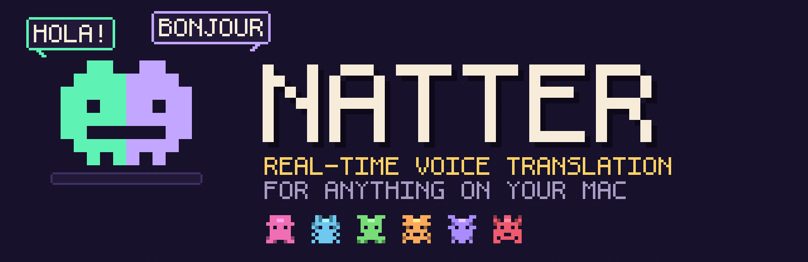
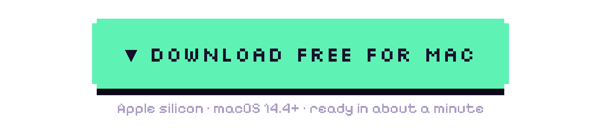
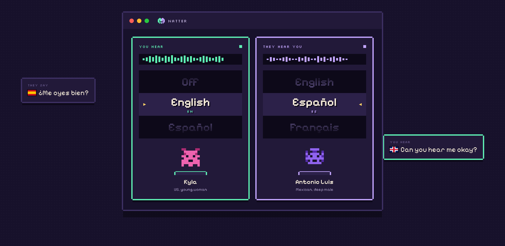
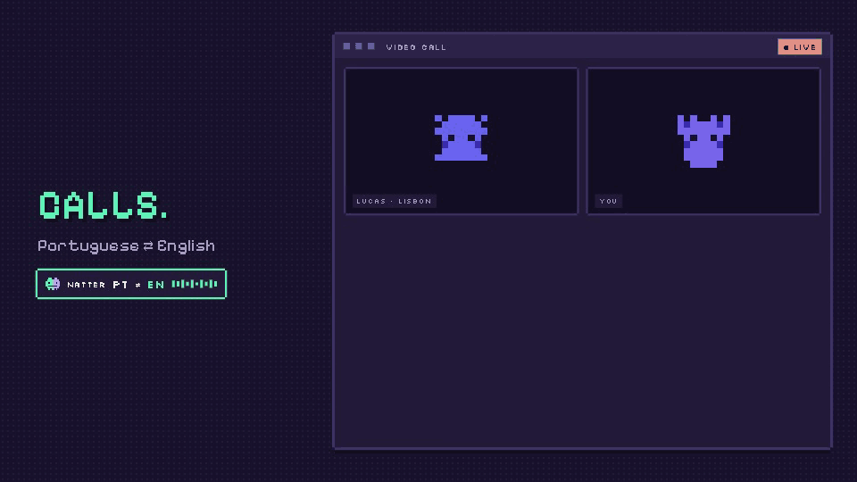
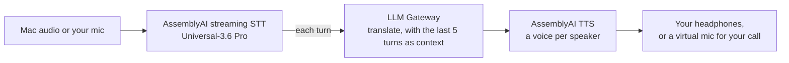

<p align="center">
  
</p>

<p align="center">
  <a href="https://github.com/dan-ince-aai/natter/releases/latest/download/Natter.dmg"></a>
</p>

<p align="center">
  <a href="https://dan-ince-aai.github.io/natter/">Website</a> ·
  <a href="https://dan-ince-aai.github.io/natter/#video">Watch the video</a> ·
  <a href="#for-developers">For developers</a>
</p>

**Natter is a free Mac app that translates speech as it happens.** Turn the left dial and anything your Mac plays (a
call, a livestream, a video, a meeting) is spoken into your headphones in your language. Turn the right dial and the
people on your call hear *you* in theirs. Every voice is a little pixel critter you can swap on the fly.

<p align="center"></p>

<p align="center">
  <a href="https://dan-ince-aai.github.io/natter/#video"></a><br>
  <a href="https://dan-ince-aai.github.io/natter/#video"><b>▶ Watch the full video with sound</b></a>
</p>

## What you can do with it

| | |
|---|---|
| **Calls in any app** | Zoom, Meet, Teams, Slack huddles. Natter shows up as your microphone, so there's nothing to install on the other side. |
| **Phone and VoIP** | Softphones, WhatsApp desktop, browser dialers. Anything that plays through your Mac. |
| **Livestreams and videos** | Dub a stream or a video as it plays, with the original turned down to 10% underneath. |
| **Meetings** | Every speaker gets their own critter voice, so you always know who's talking. |
| **A global call centre** | Give every agent Natter and take calls in languages nobody on the team speaks. |

**Six languages, any direction:** English, Español, Français, Deutsch, Italiano and Português, in any of 30 pairs.

**About 50 hours free:** Natter itself is free. Translation runs on your own AssemblyAI account, and new accounts get
$50 of credit with no card needed. That's roughly 65 hours of listening to calls, 45 of dubbing video, or 35 of two-way
calls ([how we worked it out](https://dan-ince-aai.github.io/natter/#hours)).

## Get started

1. [**Download Natter.dmg**](https://github.com/dan-ince-aai/natter/releases/latest/download/Natter.dmg) and drag
   Natter to Applications. (Apple silicon, macOS 14.4 or later.)
2. Open it. If macOS says it can't check the app (it isn't notarised yet), go to **System Settings → Privacy &
   Security → Open Anyway**.
3. Paste your AssemblyAI API key ([get a free key](https://www.assemblyai.com/dashboard/api-keys)). It's kept in your
   Keychain.
4. Turn a dial. Allow microphone and system audio when macOS asks.

To talk on calls, or to turn the original down while you listen, install the free BlackHole audio drivers once:
`brew install blackhole-2ch blackhole-16ch`, then restart your Mac.

## Using it

- **The dials.** Each starts at **Off**. Drag, scroll or click to a language and that direction switches on; back to
  Off and it stops. The left dial is the language you hear; the right is the language they hear you in.
- **The critters.** Drag the row under a dial to change voice, live, mid-conversation. Star your favourites. Natter
  remembers your voice for each language, and with **a voice for each speaker** on, you can pick a voice for anyone.
- **Original audio** (left card): full, 25%, 10% or muted while you listen. Full volume comes back when you turn the dial
  to Off.
- **Style** (right card): sound natural, formal, friendly, or like your brand: tone, words to use and avoid, product
  names kept exact. For example, "yeah no worries mate, it's no big deal" can become "No se preocupe, podemos gestionar
  ese reembolso por usted hoy mismo. Nos alegra poder ayudarle."
- **Menu bar.** The critter icon switches Listen and Talk without the window, shows a subtitle overlay above every app,
  and has **Restore sound**, which puts your Mac's output and mic back on your real devices.

## Troubleshooting

- **No sound after using Natter.** Click the critter in the menu bar → **Restore sound**. Natter also restores your
  output and mic at its next launch if it ever quits mid-translation.
- **"System audio is silent".** Allow Natter in System Settings → Privacy & Security → Screen & System Audio Recording.
- **The call can't hear you.** Set the call app's microphone to *Same as System* or *BlackHole 2ch*.
- **AirPods and Talk.** Using the AirPods mic switches them to call-quality audio, as in any call app.

<br>

---

## For developers

Natter is open source (MIT) and built entirely on AssemblyAI's APIs, so take the pattern and put real-time translation
in your own product.

### Build real-time translation into your app

It's one WebSocket for speech-to-text **and** translation, plus one for the voice. The trick is the `llm_gateway`
parameter: it runs your prompt on every finished turn, on the same streaming session.

```python
stt = connect("wss://streaming.assemblyai.com/v3/ws",
    sample_rate=16000, encoding="pcm_s16le", speech_model="universal-3-6-pro", mode="min_latency",
    llm_gateway=json.dumps({
        "model": "gemini-2.5-flash-lite",
        "prompt": "Translate what the speaker just said into natural Spanish. Reply with only the translation.\n\n{{turn}}",
    }))
# ...stream mic audio in; each translation arrives as an LLMGatewayResponse message.
# Send it to wss://tts.us.assemblyai.com/v1/ws as {"type": "Generate", "text": ...} + {"type": "Flush"} and play the audio.
```

[`examples/realtime_translate.py`](examples/realtime_translate.py) is the whole loop in about 100 lines: mic →
speech-to-text + translation → text-to-speech → speakers.

```sh
pip install websockets sounddevice numpy
export ASSEMBLYAI_API_KEY=your-key   # https://www.assemblyai.com/dashboard/api-keys
python examples/realtime_translate.py --to Spanish --voice aai-antonioluis   # wear headphones
```

**Ideas to build:** a browser extension that dubs any tab, a phone-line interpreter (Twilio or SIP in, translated audio
out), live subtitles for streams, a Windows or Linux port, a support desk where every agent speaks every language. If
you build something, open an issue and tell us.

### How Natter works



- **Listen** captures what your Mac plays with a Core Audio process tap (or, when you turn the original down, by
  routing system output through a silent virtual device), transcribes it, translates each turn, and speaks it.
- **Talk** does the same with your microphone and plays the result into a virtual mic (BlackHole), which your call app
  uses as its microphone. Natter switches the Mac's default mic for you and switches it back when you stop.
- Translations play in the order they were spoken and never overlap. If they fall behind, Natter shortens pauses and
  speeds the voice up (pitch kept) until it catches up.
- Speech ends → translated voice starts in about 1.0–1.5 s (measured 8 November 2026 on a two-speaker test dialogue).

### Extending it

- **Change what it does.** Settings → Advanced → Instructions is the LLM prompt (`{source}`, `{target}`, `{{turn}}`,
  `{{history_5}}`). Make it summarise, simplify, or speak like a pirate.
- **Use another LLM.** Any model on [AssemblyAI's LLM Gateway](https://www.assemblyai.com/docs); add it to `LLM_MODELS`.
- **Add voices.** `VOICES` in `app.py` maps languages to TTS voice IDs.
- **Drive it from your own code.** The engine is a local server on `127.0.0.1:18765`: `POST /api/start/{in|out}`,
  `/api/stop/{lane}`, `/api/config`, `/api/speak/{lane}`, and `ws://127.0.0.1:18765/ws` streams `partial`, `final`,
  `translation`, `lag` and `level` events.

### Build from source

You need macOS 14.4+, the Xcode command line tools (`xcode-select --install`) and Python 3.10+.

```sh
git clone https://github.com/dan-ince-aai/natter.git && cd natter
./build.sh        # builds the audio helpers and Natter.app
open Natter.app   # paste your AssemblyAI key when it asks
./package.sh      # optional: the self-contained dist/Natter.dmg, with its own Python inside
```

| Path | What it is |
|---|---|
| `app.py` | The engine: audio in, streaming STT, translation, TTS playback, and the local server |
| `static/` | The window (`index.html`) and the subtitles page (`captions.html`) |
| `launcher/` | `Natter.app`: the native window, menu bar icon and subtitle overlay (Swift) |
| `syscap/` | Core Audio process tap that captures what the Mac plays, minus Natter itself (Swift) |
| `audiodev/` | Reads and sets the Mac's default input and output devices (Swift) |
| `examples/` | The standalone real-time translation example |
| `docs/` | The website |

### Roadmap

- A signed, notarised download (no "Open Anyway" step)
- Sign in with AssemblyAI instead of pasting a key
- More voices per language, and voices for more languages

### Contributing

Issues and pull requests are welcome. See [CONTRIBUTING.md](CONTRIBUTING.md).

### Licence

[MIT](LICENSE). Natter uses [AssemblyAI](https://www.assemblyai.com) for speech-to-text, translation (LLM Gateway) and
text-to-speech; usage is billed to your own API key. Natter identifies itself in its requests to AssemblyAI with the
user agent `Natter/<version>`, which contains no personal or device data.

<p align="center"></p>
